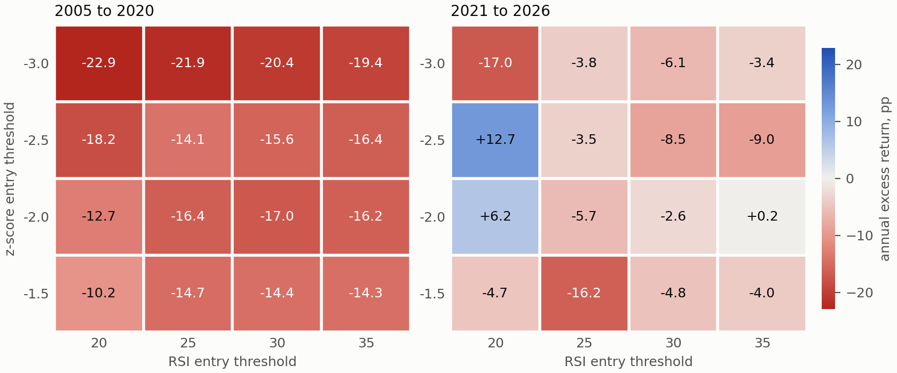

# Oversold-entry rules on the Warsaw Stock Exchange

A backtest of z-score and RSI entry thresholds, 2005 to 2026

Michał Piaskowski, October 2026

## Summary

This repository evaluates a rule that buys a security when its price is low relative to its own 63-session mean and its 14-session RSI is low, and sells when either measure recovers or after 60 sessions. A grid of 144 threshold combinations is tested on daily Warsaw Stock Exchange (WSE) data in two disjoint windows, net of a 0.39 per cent commission per side, against the equal-weighted portfolio of the same liquid universe.

In the 2021 to 2026 window, 27 of 144 variants have a higher annual return than the benchmark and the best variant returns 31.5 per cent per year against 15.9 per cent. Its alpha is not significant on its own (p = 0.143), no alpha is significant after Holm adjustment, and White's Reality Check does not reject the null of no superior variant (p = 0.29). In the 2005 to 2020 window no variant exceeds the benchmark; 24 alphas are negative and significant after Holm adjustment. No variant has a positive excess return in both windows, and the rank correlation of excess returns between the windows is 0.069 (p = 0.41).

A fixed-horizon test without an exit rule indicates that the underperformance is associated with the entry signal. Features computed from price and turnover separate securities that later fail, but excluding those securities does not improve the outcome of the signal.

The results are specific to this sample, grid and cost assumption.

## 1. Rule and grid

For each security and session, two quantities are computed from adjusted closing prices:

- z-score: the price minus its 63-session rolling mean, divided by the 63-session rolling standard deviation;
- RSI: Wilder's (1978) relative strength index over 14 sessions.

A position is opened when the z-score and the RSI are both at or below the entry thresholds. It is closed when the z-score or the RSI reaches its exit threshold, or after 60 sessions. Positions are equally weighted.

| Parameter | Values |
|---|---|
| z-score entry threshold | −3.0, −2.5, −2.0, −1.5 |
| RSI entry threshold | 20, 25, 30, 35 |
| z-score exit threshold | 0.0, 0.5, 1.0 |
| RSI exit threshold | 55, 65, 70 |
| maximum holding period | 60 sessions |

The grid contains 4 × 4 × 3 × 3 = 144 variants.

## 2. Data and design

The panel covers 5,438 sessions from 4 January 2005 to 28 September 2026 and 724 securities identified by ISIN. Prices are adjusted for corporate actions. The source data come from the WSE quotation archive and cannot be redistributed; Section 9 lists the required inputs.

**Securities removed from trading.** The panel contains every security quoted on a given session. Of the 724 return series, 321 end more than 40 sessions before the end of the sample. The sample is therefore not conditioned on survival. Section 7 reports the sensitivity of the results to assumed delisting returns.

**Universe.** A security belongs to the universe on day t if its median daily turnover over the previous 63 sessions, lagged by one session, exceeds PLN 100,000. From 2021 the universe contains 147 securities per session on average.

**Execution.** A signal computed at the close of day t is executed at the close of day t+1.

**Costs.** A commission of 0.39 per cent per side is charged. Bid-ask spreads and price impact are not modelled.

**Benchmark.** The equal-weighted daily return of all securities in the universe, with at least 20 members required.

**Inference.** Alpha is the intercept of a regression of the daily strategy return on the benchmark return, with Newey and West (1987) standard errors and 10 lags. Holm (1979) adjusted p-values are computed over the 144 alphas. White's (2000) Reality Check uses the stationary bootstrap of Politis and Romano (1994) with a mean block length of 10 sessions and 2,000 replications.

## 3. Results

### 3.1. Window 2021 to 2026

The window has 1,437 sessions.

| | Annual return | Sharpe ratio | Maximum drawdown |
|---|---|---|---|
| Benchmark | 15.9% | 1.08 | −26.3% |
| Median of 144 variants | 11.3% | 0.57 | |
| Best variant (no. 41) | 31.5% | 0.95 | −33.9% |

- Annual alpha of the best variant is 17.8 per cent with p = 0.143.
- Three alphas have an unadjusted two-sided p-value below 0.05; all three are negative. None is significant after Holm adjustment.
- The Reality Check p-value is 0.29.
- The median variant makes 442 trades; the median difference between gross and net annual return is 2.8 percentage points.

**Split-sample check.** The window is split at 10 November 2023. The variant with the highest excess return in the first half (no. 15, +8.6 percentage points per year) has an excess return of −18.3 percentage points per year in the second half, where 136 of 144 variants do better. Eight variants have a positive excess return in both halves. The rank correlation between the halves is 0.294 (p < 0.001). Because the variants trade largely the same securities on the same sessions, this correlation is not interpreted as evidence of predictive content.

### 3.2. Window 2005 to 2020

The window has 4,001 sessions and shares none with the previous one.

| | Annual return | Sharpe ratio | Maximum drawdown |
|---|---|---|---|
| Benchmark | 7.2% | 0.46 | −74.9% |
| Median of 144 variants | −8.8% | −0.16 | |
| Best variant (no. 116) | −0.3% | 0.19 | −81.5% |

- No variant has a positive alpha or an annual return above the benchmark. The median excess return is −16.0 percentage points per year and the highest is −7.6.
- 98 alphas have an unadjusted p-value below 0.05 and 24 remain significant after Holm adjustment. All are negative.
- The Reality Check p-value is 0.99.
- In the split-sample check, no variant has a positive excess return in both halves; the rank correlation is 0.108 (p = 0.20).

### 3.3. Across windows

| Best variant in | Excess return in 2005 to 2020 | Excess return in 2021 to 2026 | Rank in the other window |
|---|---|---|---|
| 2021 to 2026 (no. 41) | −16.7 pp | +15.6 pp | 80 of 144 |
| 2005 to 2020 (no. 116) | −7.6 pp | −7.3 pp | 104 of 144 |

The rank correlation of excess returns between the windows is 0.069 (p = 0.41). No variant has a positive excess return in both windows.

### 3.4. Parameter surface

*Figure 1. Mean annual excess return over the benchmark by entry thresholds, in percentage points, averaged over the nine exit-threshold combinations, net of costs.*

In the 2005 to 2020 window all cells are negative. In the 2021 to 2026 window the two positive cells (+12.7 and +6.2) are adjacent to the lowest cell (−17.0), and the surface is not smooth in either threshold.

## 4. Diagnostics

The diagnostics use the middle variant of the grid (z-score entry −2.0, RSI entry 30, z-score exit 0.5, RSI exit 65) over the full sample, 2005 to 2026, gross of costs. The benchmark returns 9.4 per cent per year.

### 4.1. Fixed holding period

Securities are bought on the signal and held for exactly N sessions, in a calendar-time portfolio. There is no exit rule. The sample has 25,231 entry events.

| Holding period | Annual return | Annual alpha | p |
|---|---|---|---|
| 5 sessions | 5.0% | 2.5% | 0.753 |
| 10 sessions | −3.4% | −7.9% | 0.231 |
| 21 sessions | −6.0% | −12.9% | 0.006 |
| 63 sessions | −0.6% | −9.3% | < 0.001 |
| 126 sessions | 1.4% | −7.4% | < 0.001 |
| 252 sessions | 5.7% | −2.9% | 0.011 |

Alpha is negative at every horizon from 10 sessions and significant from 21 sessions. Since this test involves no exit rule, the underperformance is associated with the entry signal.

### 4.2. Exit reasons

The rule produces 3,944 trades with a mean gross return of −0.13 per cent.

| Exit reason | Share | Mean days held | Mean return | Positive |
|---|---|---|---|---|
| z-score threshold | 46% | 34 | 13.28% | 92% |
| RSI threshold | 16% | 35 | 8.51% | 74% |
| Time limit | 38% | 61 | −20.16% | 7% |

### 4.3. Returns after exit

Return of the security in excess of the benchmark, measured from the exit day.

| Sessions after exit | Mean excess return | Positive |
|---|---|---|
| 21 | −1.05% | 42% |
| 63 | −2.09% | 41% |
| 126 | −3.25% | 39% |

Mean excess returns after exit are negative, which does not support the view that positions are closed too early.

### 4.4. Return before entry

On the entry day the median security has a return of −9.3 per cent over the previous year and −14.2 per cent over the previous quarter.

| One-year return before entry | Share of trades | Mean return | Positive | Closed at time limit |
|---|---|---|---|---|
| below −50% | 15% | −4.60% | 44% | 47% |
| −50% to −25% | 18% | −1.59% | 53% | 40% |
| −25% to 0% | 21% | 0.46% | 59% | 36% |
| 0% to +25% | 17% | 1.35% | 63% | 34% |
| above +25% | 21% | 2.88% | 63% | 33% |

Shares do not sum to 100 per cent because the one-year return is unavailable for some trades. Mean trade return increases monotonically with the prior one-year return. This pattern is consistent with the momentum effect (Jegadeesh and Titman, 1993): the signal selects securities with negative prior returns. The relation is descriptive and was examined after the main results were known.

## 5. Price-based distress features

This section asks whether features available on the signal date distinguish securities that subsequently fail, and whether removing them changes the outcome of the signal.

**Definition of failure.** Removal from trading is not treated as failure. Of the ended series with a computable return over the last year of trading, 30 per cent end with a gain above 20 per cent and 26 per cent with a loss beyond 20 per cent. A security is classified as failed when its series ends and its return over the last year of trading is below −50 per cent; 60 securities meet this criterion. An event is followed by failure if the series ends within 252 sessions of the signal.

The sample has 22,301 signal events with complete features. The outcome is the return in excess of the benchmark over 126 sessions, or to the end of trading if earlier. Its mean is −4.71 per cent.

**Failure rate by feature quintile.**

| Feature | Q1 | Q5 |
|---|---|---|
| Volatility (63 sessions) | 0.0% | 3.5% |
| Daily high-low range | 0.0% | 2.8% |
| Price (PLN) | 2.8% | 0.0% |
| Drawdown from one-year high | 3.0% | 0.0% |
| One-year return | 3.0% | 0.2% |

Each of these features separates subsequent failures in the expected direction.

**Effect of removing failures.** Failures account for 183 events (0.82 per cent). Excluding all of them, using information not available at the signal date, changes the mean excess return from −4.71 to −4.37 per cent.

| Excess return after 126 sessions | Share of events | Contribution to the mean |
|---|---|---|
| below −50% | 6.7% | −4.50 pp |
| −50% to −25% | 17.9% | −6.26 pp |
| −25% to −10% | 21.8% | −3.72 pp |
| −10% to 0% | 15.0% | −0.76 pp |
| above 0% | 38.6% | +10.53 pp |

The largest negative contribution comes from events with an excess return between −50 and −25 per cent, most of which are not followed by failure.

**Combined filter.** Excluding the top volatility quintile, the bottom price quintile and the bottom drawdown quintile retains 13,784 events (62 per cent). The failure rate falls from 0.82 to 0.08 per cent and the mean excess return changes from −4.71 to −5.57 per cent. In this sample the features associated with failure are also associated with higher subsequent returns among the securities that do not fail, so the filter lowers the failure rate without improving the mean outcome.

The quintile and filter thresholds are computed on the full sample; the analysis is descriptive and does not constitute an out-of-sample test of a filter.

## 6. Returns after distress-related current reports

`08_espi_events.py` measures excess returns after current reports (ESPI) classified by subject into bankruptcy, restructuring, reporting delay, audit issues and financial distress. Categories with fewer than 20 matched events at a given horizon are not reported. The sample has 5,307 events for 351 securities. P-values are obtained by resampling event dates and are not adjusted for the 16 comparisons.

| Category | N | 5 sessions | 21 sessions | 63 sessions | 126 sessions |
|---|---|---|---|---|---|
| Bankruptcy | 275 | −1.02% (0.223) | −2.34% (0.141) | −2.86% (0.186) | −3.27% (0.211) |
| Restructuring | 572 | 1.54% (0.036) | 1.23% (0.280) | 4.73% (0.080) | 1.14% (0.719) |
| Reporting delay | 4,247 | 0.17% (0.157) | 0.25% (0.394) | 1.47% (0.029) | 2.93% (0.005) |
| Financial distress | 86 | 0.10% (0.979) | 8.53% (0.005) | 5.83% (0.167) | −1.41% (0.805) |

*Mean excess return over the benchmark; p-value in parentheses.*

These results are exploratory. The classification is based on report subjects and has not been validated. The adjusted price index is flat after a security's last session, so returns of securities that stop trading within the horizon may be overstated. No conclusion is drawn from the positive estimates.

## 7. Sensitivity to delisting returns

In the baseline, a position in a security removed from trading is closed at the last quoted price. `09_delisting_returns.py` follows the approach of Shumway (1997) and assigns a return on the first session after the last quotation according to the reason for removal recorded by the exchange: −100 per cent for bankruptcy or liquidation (28 securities), −30 per cent for exclusion or rule violation and for removals without a recorded reason (188 securities), and 0 per cent for tender offers, mergers and dematerialisation (105 securities). A reason is recorded for 154 of the 321 ended series. The assigned values are assumptions.

| | 2021 to 2026, baseline | with delisting returns | 2005 to 2020, baseline | with delisting returns |
|---|---|---|---|---|
| Benchmark annual return | 15.9% | 15.4% | 7.2% | 7.1% |
| Median variant annual return | 11.3% | 10.7% | −8.8% | −9.0% |
| Variants above the benchmark | 27 | 30 | 0 | 0 |
| Holm-significant alphas (all negative) | 0 | 0 | 24 | 29 |
| Reality Check p-value | 0.29 | 0.31 | 0.99 | 0.99 |

The adjustment lowers both the benchmark and the strategy returns. With delisting returns, the rank correlation between the windows is −0.039 (p = 0.65) and no variant has a positive excess return in both windows. The conclusions of Section 3 are unchanged.

## 8. Limitations

- Results are based on closing prices. Bid-ask spreads and price impact are not modelled, which is likely to overstate net returns for a rule with several hundred trades per variant.
- The 144 variants are strongly dependent. Holm adjustment is conservative under positive dependence, and the split-sample rank correlation within a window is affected by the overlap of trades.
- The 2005 to 2020 window was examined after the 2021 to 2026 results, with the grid, the cost assumption and the liquidity threshold unchanged. The diagnostics in Sections 4 to 6 were specified after the main results were known and are exploratory.
- Delisting returns are assumed, not observed.
- The benchmark is equal-weighted and rebalanced daily without costs.

## 9. Reproduction

### Requirements

Python 3.10 or later.

    pip install -r requirements.txt

### Input data

The input files are not included. The scripts expect the following files in `data/`. Column names follow the source files and are in Polish.

| File | Content |
|---|---|
| `adjusted_prices.parquet` | Sessions × ISIN matrix of prices adjusted for corporate actions. Flat after a security's last session. |
| `daily_returns.parquet` | Sessions × ISIN matrix of daily returns. Missing when the security is not quoted. |
| `panel.parquet` | Long panel with columns `data` (date), `isin`, `zamkniecie` (close), `max` (high), `min` (low), `wolumen` (volume), `obrot_pln` (turnover in PLN). |
| `wse_delistings.csv`, `wse_suspensions_exclusions.csv` | WSE notices with columns `isin`, `rodzaj` (type), `przyczyna` (reason), `mic`. Used by script 09. |
| `espi_events.csv` | Columns `isin`, `data` (report date), `zdarzenie` (category). Used by script 08. |

### Running

    ./run_all.sh

The script runs the full pipeline in several minutes. Individual steps:

| Script | Purpose |
|---|---|
| `code/01_signals.py` | z-score, RSI and universe membership |
| `code/02_backtest.py START END LABEL` | grid backtest, net and gross of costs |
| `code/03_tests.py LABEL` | alpha, Holm adjustment, Reality Check |
| `code/04_robustness.py LABEL` | split-sample check, parameter surface |
| `code/05_period_comparison.py` | comparison of the two windows |
| `code/06_diagnostics.py` | fixed-horizon test, exit reasons, post-exit returns |
| `code/07_distress_filter.py` | price-based distress features |
| `code/08_espi_events.py` | returns after current reports |
| `code/09_delisting_returns.py` | delisting-return adjustment |
| `code/10_figures.py` | Figure 1 |

Setting `DATA_SUFFIX=_dl` makes scripts 01 and 02 use the inputs produced by script 09.

### Results

`results/<label>/` contains `summary.csv`, `statistics.csv`, `significance.csv` and `robustness.csv` for each window; labels ending in `_dl` include delisting returns. Daily return series and event-level files are produced locally and are not tracked. The bootstrap seed is fixed, so the reported figures are reproduced exactly from the same inputs.

## References

Holm, S. (1979). A simple sequentially rejective multiple test procedure. *Scandinavian Journal of Statistics*, 6(2), 65–70.

Jegadeesh, N., & Titman, S. (1993). Returns to buying winners and selling losers: implications for stock market efficiency. *Journal of Finance*, 48(1), 65–91.

Newey, W. K., & West, K. D. (1987). A simple, positive semi-definite, heteroskedasticity and autocorrelation consistent covariance matrix. *Econometrica*, 55(3), 703–708.

Politis, D. N., & Romano, J. P. (1994). The stationary bootstrap. *Journal of the American Statistical Association*, 89(428), 1303–1313.

Shumway, T. (1997). The delisting bias in CRSP data. *Journal of Finance*, 52(1), 327–340.

White, H. (2000). A reality check for data snooping. *Econometrica*, 68(5), 1097–1126.

Wilder, J. W. (1978). *New Concepts in Technical Trading Systems*. Trend Research.

## Licence

Code is released under the MIT Licence. The study is not investment advice.
